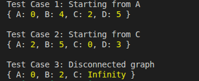

# GMC-Implementing-Dijkstra-s-Algorithm

# Dijkstra's Algorithm in JavaScript

## Overview

This project implements Dijkstra's algorithm to find the shortest distances from a starting vertex to all other vertices in a weighted graph.

Dijkstra's algorithm is commonly used to solve shortest-path problems, such as finding the shortest route between locations or determining the minimum cost of traveling through a network.

The graph is represented using a JavaScript object:

- **Vertices:** Represented by the object's keys.
- **Edges:** Represented by the neighboring vertices listed under each key.
- **Weights:** Represented by the values associated with neighboring vertices.

The function `dijkstra(graph, start)` returns an object containing the shortest distance from the starting vertex to every vertex in the graph.

## Technologies

- JavaScript
- Node.js

No external libraries are required.

## Implementation

### Function: `dijkstra(graph, start)`

The function accepts two parameters:

- `graph`: An object representing the weighted graph and its connections.
- `start`: The vertex from which the shortest distances are calculated.

It returns an object whose keys are vertices and whose values are their shortest distances from the starting vertex.

### How the Algorithm Works

1. Initialize the distance to every vertex as infinity.
2. Set the distance to the starting vertex to zero.
3. Find the unvisited vertex with the smallest known distance.
4. Mark that vertex as visited.
5. Examine its neighboring vertices and calculate the distance through the current vertex.
6. Update a neighbor's distance if the newly calculated distance is smaller than its current distance.
7. Repeat until all reachable vertices have been visited or no reachable unvisited vertices remain.
8. Return the distances object.

The implementation uses a `Set` to keep track of visited vertices.

## Example

The following graph is provided in the checkpoint:

```javascript
const graph = {
  A: { B: 4, C: 2 },
  B: { A: 4, C: 5, D: 10 },
  C: { A: 2, B: 5, D: 3 },
  D: { B: 10, C: 3 },
};
```

Calling:

```javascript
dijkstra(graph, "A");
```

Returns:

```javascript
{
    A: 0,
    B: 4,
    C: 2,
    D: 5
}
```

### Explanation

- **A:** The starting vertex, so its distance is `0`.
- **B:** The shortest route is A → B, with a cost of `4`.
- **C:** The shortest route is A → C, with a cost of `2`.
- **D:** The shortest route is A → C → D, with a total cost of `2 + 3 = 5`.

Although there is a direct connection from B to D with a weight of `10`, going through C gives a shorter route from A to D.

## How to Run

Make sure Node.js is installed.

Open a terminal in the project directory and run:

```bash
node index.js
```

The program executes three use cases and displays the resulting distance objects.

## Tests



## Complexity Analysis

Let:

- `V` represent the number of vertices.
- `E` represent the number of edges.

### Time Complexity: O(V² + E)

The algorithm searches through all vertices to find the unvisited vertex with the smallest distance. This search can take O(V) time and is repeated up to V times, resulting in O(V²).

The algorithm also examines the neighboring edges, requiring O(E) additional time.

Therefore, the overall time complexity is **O(V² + E)**, commonly expressed as O(V²) for a simple graph.

This implementation does not use a priority queue or min-heap.

### Space Complexity: O(V)

The distances object and visited set each store information about the vertices.

The additional space required by the algorithm is O(V), excluding the input graph.

## Conclusion

This project demonstrates how Dijkstra's algorithm calculates shortest distances in a weighted graph.

By repeatedly selecting the unvisited vertex with the smallest known distance and updating the distances to its neighbors, the algorithm finds the shortest paths from the starting vertex to every reachable vertex.

The implementation uses a JavaScript object to represent the graph and returns the shortest distances in the format required by the checkpoint.
